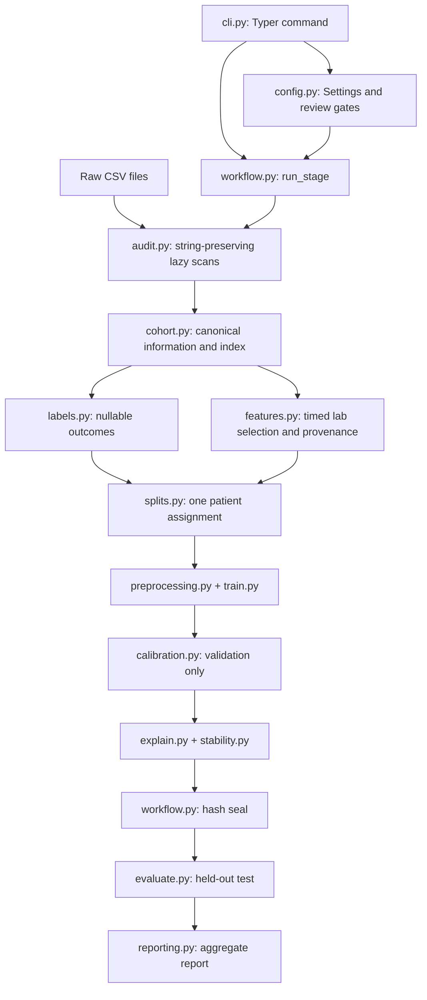

# PreOp-XAI: architecture, source code, configuration, and usage

This guide explains the implementation in `src/preop_xai`, from raw CSV ingestion
to persisted models, explanations, and reports. It describes the code as inspected
on 18 October 2026. Commands run from the repository root unless stated otherwise.

**One-line tour:** YAML settings select sources and review decisions; Typer calls
explicit workflow stages; those stages build patient-level tables, fit and calibrate
two models, explain them, seal the experiment, and evaluate the held-out patients.

## Contents

1. [Purpose and terminology](#1-purpose-and-terminology)
2. [Repository and architecture](#2-repository-and-architecture)
3. [Installation and first commands](#3-installation-and-first-commands)
4. [How Typer works here](#4-how-typer-works-here)
5. [Configuration reference](#5-configuration-reference)
6. [Raw data ingestion and audit](#6-raw-data-ingestion-and-audit)
7. [Cohort construction](#7-cohort-construction)
8. [Outcome labels](#8-outcome-labels)
9. [Feature construction and leakage checks](#9-feature-construction-and-leakage-checks)
10. [Patient partitions](#10-patient-partitions)
11. [Preprocessing and model training](#11-preprocessing-and-model-training)
12. [Calibration and operating thresholds](#12-calibration-and-operating-thresholds)
13. [SHAP explanations](#13-shap-explanations)
14. [Explanation stability](#14-explanation-stability)
15. [Freeze and held-out evaluation](#15-freeze-and-held-out-evaluation)
16. [Reports and artifact reference](#16-reports-and-artifact-reference)
17. [Complete execution recipes](#17-complete-execution-recipes)
18. [Source-code reference](#18-source-code-reference)
19. [Tests and troubleshooting](#19-tests-and-troubleshooting)
20. [Extension points and current boundaries](#20-extension-points-and-current-boundaries)

## 1. Purpose and terminology

PreOp-XAI is a local, file-based research application comparing regularized
Logistic Regression (LR) and XGBoost for preanesthetic risk prediction in MOVER
EPIC. Its primary endpoint is **in-hospital mortality**. A respiratory endpoint is
conditional on separate review and explicit positive and negative assessments.

The prediction cutoff, `t0`, is the operation's anesthesia start. Inputs are:

```text
age, sex, asa, hemoglobin, platelets, creatinine, bun, sodium, potassium, glucose
```

The intended observation is one indexed eligible adult operation per patient.
Identifiers and timestamps support linkage and auditing; they are not predictors.
The implementation is a retrospective internal-validation workflow, not a serving
API, a web application, or an automated clinical approval system.

| Term | Meaning in this project |
|---|---|
| Raw source | An original CSV in the configured source directory |
| Canonical table | A DataFrame using the project's internal column names |
| Cohort | The indexed patients and operations, before excluding unknown endpoint labels |
| Assessable | The requested endpoint has an explicit nonmissing `0` or `1` label |
| Provenance | Evidence for why a laboratory candidate was selected or rejected |
| Stage | One persisted workflow operation, such as `build-features` or `train` |
| sklearn pipeline | One fitted preprocessing transformer followed by one estimator |
| Bundle | Pipeline plus model-selection metadata, calibrator, and operating threshold |
| Freeze/seal | Stored hashes checked before held-out evaluation |
| Paired bootstrap | The same sampled patient positions are used for both models |

There are **two meanings of pipeline**: the research workflow across files, and
the scikit-learn `Pipeline` inside each model. Typer exposes the former; training
constructs the latter.

## 2. Repository and architecture

```text
PreOp-XAI/
  .python-version             Python 3.11.9
  pyproject.toml              package metadata, dependencies, console entry point
  uv.lock                     resolved dependency versions
  configs/
    study.yaml                shipped, deliberately unreviewed study settings
    local.example.yaml        template for an independent local settings file
    feature_map.yaml          laboratory identities, units, timing, bounds
    outcomes.yaml             mortality and respiratory coding rules
  src/preop_xai/
    __init__.py               package version
    cli.py                    Typer application and command functions
    config.py                 YAML loading, review checks, hashes, JSON output
    workflow.py               stage dispatch, persisted files, experiment seals
    audit.py                  lazy CSV scans and source inventories
    cohort.py                 information adapter and patient indexing
    labels.py                 explicit nullable outcome construction
    features.py               laboratory adapter, selection, leakage audit
    splits.py                 one patient-level partition assignment
    preprocessing.py          strict model-input schema and transformers
    train.py                  cross-validation and fitted ModelBundle objects
    calibration.py            validation recalibration and operating thresholds
    explain.py                raw/calibrated-logit SHAP and figures
    stability.py              paired bootstrap explanation refits
    evaluate.py               fixed-prediction metrics and uncertainty
    reporting.py              aggregate Markdown report generation
    demo.py                   artificial source generation and full workflow
  tests/                      data, model, explanation, and workflow contracts
  docs/                       protocol, implementation records, and this guide
  data/                       ignored authorized source data
  artifacts/                  ignored generated analysis products
  reports/                    ignored optional report storage
```

`reports/` is not the default report destination. `report` writes
`<output_dir>/report.md`.

### 2.1 Dependency direction



The workflow coordinates files; domain modules implement the calculations. There
is no scheduler, database, dependency graph engine, or implicit prerequisite
execution. Calling `train` does not first ingest data or build partitions.

### 2.2 Data and state boundaries

- Polars handles lazy raw CSV projection, filtering, joins, and aggregation.
- Compact canonical and modeling tables cross into pandas.
- Parquet persists tables between commands.
- scikit-learn handles preprocessing, LR, and cross-validation.
- XGBoost supplies the second estimator; SHAP explains fitted estimators.
- Joblib persists Python bundles; JSON/CSV/PNG/NPZ store analysis outputs.
- YAML carries settings and reviewed source dictionaries.

Most modules have no CLI dependency. `workflow.py` owns the connection between
settings, domain calls, filenames, and console completion messages. Many domain
imports occur inside stage branches, although importing `workflow.py` still
imports pandas, NumPy, joblib, and preprocessing.

## 3. Installation and first commands

The package requires Python `>=3.11,<3.12`; `.python-version` pins `3.11.9`.
`pyproject.toml` names dependencies without exact versions; `uv.lock` supplies the
resolved versions used by locked commands.

```sh
uv sync --locked
uv run --locked python --version
uv run --locked preop-xai --help
uv run --locked preop-xai build-features --help
```

`uv sync --locked` prepares the project environment. `uv run --locked` executes
inside it without silently updating the dependency lock.

To explore without real patient data:

```sh
uv run --locked preop-xai demo --output artifacts/demo-guide
```

Use a new or empty output directory. The demo refuses a nonempty directory.
It is a full computational campaign, not just example text or mocked results:
600 artificial patients, both endpoints, complete candidate searches, SHAP,
ten stability refits per model/endpoint, and 1,000 evaluation bootstrap draws per
endpoint. Its report is `artifacts/demo-guide/report.md`.

The demo creates synthetic CSVs and generated YAML inside its own output root,
then calls the same `run_stage` implementation used by ordinary commands.
The artificial review settings do not approve real source data.

## 4. How Typer works here

Source: [`cli.py`](../src/preop_xai/cli.py) and
[`pyproject.toml`](../pyproject.toml).

### 4.1 Entry point

The package declares:

```toml
[project.scripts]
preop-xai = "preop_xai.cli:app"
```

Installing the project creates the `preop-xai` console command. The target is
the `app` object in `preop_xai.cli`:

```python
app = typer.Typer(no_args_is_help=True, pretty_exceptions_enable=False)
Config = Annotated[Path, typer.Option("--config", exists=True, dir_okay=False)]
```

- `Typer(...)` creates the application.
- `no_args_is_help=True` displays help when invoked without a subcommand.
- `pretty_exceptions_enable=False` disables Typer's rich exception presentation.
- `Annotated` keeps the Python type (`Path`) alongside CLI metadata.
- `--config` accepts an existing file path, not a directory.
- The default on each command is `Path("configs/study.yaml")`.

The module also ends with `if __name__ == "__main__": app()`, so this works:

```sh
uv run --locked python -m preop_xai.cli --help
```

There is no package `__main__.py`; use `preop_xai.cli`, not
`python -m preop_xai`.

### 4.2 Functions become commands

For example:

```python
@app.command()
def build_features(config: Config = Path("configs/study.yaml")) -> None:
    _run_stage("build-features", config)
```

The decorator registers the function. Typer converts underscores in function
names to hyphens, so `build_features` becomes `build-features`.

Default-valued parameters such as `endpoint: str = "mortality"` become options
such as `--endpoint mortality`. Their annotations determine parsing. In this
code, endpoint and partition are plain strings: workflow checks, not Typer enums,
restrict their allowed values.

```sh
uv run --locked preop-xai train --endpoint mortality --config configs/local.yaml
```

`--config` belongs to the subcommand. The code defines no application-wide
`--config` callback, so place it **after** `train`, `audit`, etc.

### 4.3 Dispatch and errors

The route for a typical command is:

```text
console entry point
  -> app parses command and options
  -> command function
  -> _run_stage(stage, config, endpoint, partition)
  -> load_settings(config)
  -> workflow.run_stage(...)
  -> domain function(s)
  -> saved artifacts and completion message
```

`_run_stage` catches `ValueError` and `FileNotFoundError`, prints their message to
stderr, and exits with code `1`. It does not catch every exception type.
`train` additionally performs its review check before importing the workflow,
so an unreviewed training request fails before scientific workflow/data access.
`demo` directly calls `run_demo`; it does not use `_run_stage`'s error wrapper.

### 4.4 Complete command reference

All commands except `demo` accept `--config`, defaulting to `configs/study.yaml`.

| Command | Additional options and defaults | Purpose |
|---|---|---|
| `audit` | None | Inventory source tables, keys, codes, times, checksums |
| `build-cohort` | None | Load information, apply indexing rules, save exclusions |
| `build-labels` | None | Apply reviewed endpoint mappings |
| `build-features` | None | Select preoperative labs and save selection evidence |
| `audit-leakage` | None | Recheck features against cohort and provenance |
| `split` | None | Save shared patient partitions and environment manifest |
| `train` | `--endpoint mortality` | Fit LR and XGBoost using training CV only |
| `calibrate` | `--endpoint mortality` | Fit validation calibrators and thresholds |
| `explain` | `--endpoint mortality`, `--partition validation` | Explain validation, or completed frozen test predictions |
| `stability` | `--endpoint mortality` | Refit on paired training bootstrap draws |
| `freeze` | `--endpoint mortality` | Seal development inputs and fitted bundles |
| `evaluate` | `--endpoint mortality`, `--partition test` | Perform one frozen held-out evaluation |
| `report` | None | Render available aggregate outputs into Markdown |
| `demo` | `--output artifacts/demo`, `--seed 2026` | Generate artificial data and run both endpoint workflows |

Endpoint choices are `mortality` and `respiratory`. `explain` accepts only
`validation` or `test`; `evaluate` accepts only `test`. There is no CLI `--quick`,
`--folds`, `--raw-dir`, `--output-dir`, or `--seed` for individual study stages.
Use YAML for those study settings; only `demo` has its own output and seed options.

Official Typer reference pages used to check the framework behavior:

```text
https://typer.tiangolo.com/tutorial/commands/name/
https://typer.tiangolo.com/tutorial/parameter-types/path/
https://typer.tiangolo.com/tutorial/terminating/
https://typer.tiangolo.com/reference/typer/
```

## 5. Configuration reference

Source: [`config.py`](../src/preop_xai/config.py) and [`configs/`](../configs).

### 5.1 Three cooperating YAML documents

```text
study.yaml or local.yaml
  |-- raw_dir / output_dir / seed / study review decisions
  |-- feature_map -> laboratory mapping YAML
  `-- outcomes    -> endpoint mapping YAML
```

`configs/local.example.yaml` is a template, **not an overlay**. There is no merge
with `study.yaml`, automatic local-file loading, environment-variable expansion,
or CLI override system beyond selecting `--config`. The selected file is loaded
on its own. Optional fields use the defaults in `load_settings`.

All relative paths, including `feature_map` and `outcomes`, are interpreted
relative to the process's current working directory, **not the YAML file's parent**.
Run from the repository root; the workflow also resolves source and lockfile
paths from there.

On PowerShell, create a local copy:

```powershell
Copy-Item configs/local.example.yaml configs/local.yaml
```

Edit that file and pass it explicitly. `configs/local.yaml` and `*.local.yaml`
inside `configs/` are ignored. To keep mapping edits local too, copy them to
`feature_map.local.yaml` and `outcomes.local.yaml`, then point your local settings
to those copies.

### 5.2 Study settings

| Key | Default or requirement | Runtime use |
|---|---|---|
| `raw_dir` | Required | Source CSV directory |
| `output_dir` | Required | Shared artifact root for the campaign |
| `feature_map` | Required | Path to laboratory mapping YAML |
| `outcomes` | Required | Path to outcome mapping YAML |
| `seed` | `2026` | Partitioning, training folds, backgrounds, bootstrap draws |
| `folds` | `5` | Requested training CV fold count |
| `evaluation_bootstraps` | `1000` | Fixed-prediction held-out bootstrap draws |
| `stability_refits` | `10` | Paired training bootstrap refits |
| `review` | Unapproved if incomplete | Primary clinical-review gate |
| `respiratory` | Disabled/unapproved if incomplete | Separate respiratory gate |
| `protocol_version` | Present in supplied files | Metadata; not a `Settings` field |
| `title` | Present in `study.yaml` | Metadata; not used to title the generated report |

`load_settings` converts numeric settings with `int(...)` and returns a frozen,
slotted `Settings` dataclass. It is not a comprehensive YAML schema validator.
`TypedDict` mapping definitions document Python shapes; they do not validate
YAML automatically. Domain functions validate the fields they consume.

Example path changes, keeping the remainder of the copied template:

```yaml
raw_dir: "D:/authorized/MOVER/EMR"
output_dir: artifacts/study-reviewed-v1
feature_map: configs/feature_map.local.yaml
outcomes: configs/outcomes.local.yaml
seed: 2026
folds: 5
evaluation_bootstraps: 1000
stability_refits: 10
```

Forward slashes are convenient for Windows paths in YAML. Spaces in CLI paths
require shell quoting.

### 5.3 Review gates

The main study review is approved only when all six values are actual YAML
booleans `true`, and both `reviewer` and `evidence` are nonempty:

```yaml
review:
  age_semantics: false
  asa_mapping: false
  anesthesia_boundary: false
  static_predictor_provenance: false
  mortality_hospitalization_linkage: false
  mortality_dispositions: false
  reviewer: ""
  evidence: ""
```

The shipped `false` values are intentional. Record actual review decisions,
not a blanket flag change to get past an error. Quoted `"true"` is a string and
does not pass checks using `is True`.

Respiratory additionally requires:

```yaml
respiratory:
  enabled: false
  postoperative_meaning: false
  explicit_negatives: false
  sufficient_events: false
  reviewer: ""
  evidence: ""
```

When running respiratory stages, `require_review` requires both primary approval
and respiratory approval. During `build-labels`, enabling respiratory in the
outcome document also triggers the study-level respiratory review check.

**Review is not transformation.** There is no configurable age calculation or
ASA recoding engine. The information adapter expects `BIRTH_DATE` to already
represent reviewed numeric age in years and `ASA_RATING_C` to already represent
canonical classes. Marking their semantics reviewed does not convert a date of
birth to age or translate arbitrary source codes.

### 5.4 Laboratory mapping

`feature_map.yaml` controls:

| Field | Meaning |
|---|---|
| `version` | Dictionary version metadata |
| `reviewed` | Must be boolean `true` before feature construction |
| `availability` | Exactly `strict` or `collection_proxy` |
| `proxy_lag_hours` | Must be exactly `24` in proxy mode |
| `file` | Optional raw filename override; default `patient_labs.csv` |
| `columns` | Canonical laboratory field to source-header mapping |
| `labs` | Exactly the seven fixed lab concepts, each with names, units, bounds |

The supplied source headers are:

```yaml
columns:
  patient_id: MRN
  operation_id: LOG_ID
  collection_time: Collection Datetime
  lab_name: Lab Name
  value: Observation Value
  unit: Measurement Units
```

Mappings are merged over `features.DEFAULT_COLUMNS`. That fallback uses
`RESULT_TIME`, `LAB_NAME`, `ORD_VALUE`, and `RESULT_UNIT`; it is not the shipped
local header mapping. The fallback `RESULT_TIME` is treated as collection time,
not automatically as result-release time.

Strict mode needs an additional mapping to a real, verified release timestamp:

```yaml
availability: strict
columns:
  # Keep the other canonical/source header mappings.
  result_time: Actual Verified Release Header
```

`Actual Verified Release Header` illustrates where your real source header goes;
it is not a column supplied by this repository. The existing local source is
documented as lacking release times. Alternatively, a reviewed protocol can
explicitly use:

```yaml
availability: collection_proxy
proxy_lag_hours: 24
```

For each lab concept:

```yaml
hemoglobin:
  names: [HGB]
  units: {g/dL: 1.0, g/L: 0.1}
  min: 0.0
  max: 30.0
```

This is the structure of a supplied candidate mapping, not an approved source
dictionary. Matching is exact and case-sensitive. Each source name must have a
single concept owner; unit factors must be positive and finite; bounds must be
finite with `min < max`. Normalization is multiplication:

```text
normalized_value = numeric_source_value * unit_factor
```

The seven concepts and supplied candidate conventions are:

| Concept | Candidate names | Supplied factors | Inclusive bounds after conversion |
|---|---|---|---|
| `hemoglobin` | `HGB` | `g/dL: 1`, `g/L: 0.1` | 0-30 |
| `platelets` | `PLT` | `10^9/L: 1`, `K/uL: 1` | 0-3000 |
| `creatinine` | `CREATININE` | `mg/dL: 1`, `umol/L: 0.011312217194570135` | 0-30 |
| `bun` | `BUN` | `mg/dL: 1` | 0-300 |
| `sodium` | `SODIUM` | `mmol/L: 1`, `mEq/L: 1` | 70-200 |
| `potassium` | `POTASSIUM` | `mmol/L: 1`, `mEq/L: 1` | 1-12 |
| `glucose` | `GLUCOSE` | `mg/dL: 1`, `mmol/L: 18.0182` | 0-2000 |

Specimen compatibility must be established by dictionary review; the selection
code does not implement a separate configurable specimen filter.

### 5.5 Outcome mapping

The supplied mortality mapping is deliberately unreviewed:

```yaml
version: "1.0-unreviewed"
mortality:
  reviewed: false
  positive_descriptions: [Expired]
  negative_descriptions: [Home Routine]
  unknown_descriptions: [Transfer, Hospice]
respiratory:
  enabled: false
  reviewed: false
  rules: []
```

Mortality requires a nonempty version, reviewed mapping, nonempty positive,
negative, and unknown description sets, and no overlap between those sets.
Unrecognized dispositions are unknown too; the unknown list does not make every
other value negative.

A respiratory rule contains:

```text
element, abbreviation, context, value, label
```

The first four fields form an exact tuple from the complication record; `label`
must be `0` or `1`. Both positive and explicit negative rules are required.
The fixture examples in `demo.py` and `tests/test_data_contracts.py` demonstrate
the syntax without claiming real-data semantics.

### 5.6 Hashing and unused metadata

`file_hash` streams SHA-256 in 1 MiB blocks. `configuration_hash` combines hashes
of the selected study YAML, feature YAML, and outcome YAML. This hashes file
bytes, not just parsed values: changing comments can change the recorded hash.

Fields such as `synthetic_only`, `version`, `title`, and `protocol_version` do
not all have the same enforcement. The demo uses synthetic labels and metadata,
but there is no universal runtime validator that rejects every inappropriate
combination of those metadata fields. Read the actual gates above as the
enforced contract.

## 6. Raw data ingestion and audit

Source: [`audit.py`](../src/preop_xai/audit.py), plus the adapters in `cohort.py`,
`labels.py`, and `features.py`.

### 6.1 Source layout

The default `raw_dir` is `data/EPIC_EMR/EMR`.

| File | Consumer | Role |
|---|---|---|
| `patient_information.csv` | Audit and cohort adapter | Identity, demographics, anesthesia, hospitalization, disposition |
| `patient_labs.csv` | Audit and lab adapter | Timed laboratory candidates |
| `patient_post_op_complications.csv` | Audit and label adapter | Exact respiratory assessment tuples |
| `patient_procedure events.csv` | Audit | Procedure-event inventory; not a model input |

The space in `patient_procedure events.csv` is part of the filename.
`build-labels` loads the complications file even when respiratory is disabled,
although mortality-only label construction does not use its assessment groups.

The audit inspects whichever named source files exist. If none of those named
files exists, it falls back to all `*.csv` files in the directory. Thus a
successful audit is not proof that every later stage's required file is present.

### 6.2 String-preserving scans

`scan_strings(path)` uses:

```python
pl.scan_csv(path, infer_schema=False, null_values=[""], try_parse_dates=False)
```

This returns a lazy plan. All columns initially remain strings, preserving
identifier formatting, source codes, literal `"None"`, and nonnumeric lab text.
Only empty fields are configured as nulls. A literal `"None"` is not silently
changed into missing data or a negative respiratory label.

Later operations select required columns, filter rows, and collect with the
streaming engine. The lab adapter performs its major reduction before pandas
materialization. The information and complication adapters still materialize
their selected tables, and a large set of lab candidates can still require
substantial memory. Lazy ingestion is not a claim of constant-memory modeling.

### 6.3 What `audit_raw` writes

```sh
uv run --locked preop-xai audit --config configs/local.yaml
```

For each inspected table, the audit records:

- File size and a streaming SHA-256 checksum.
- Observed column names and the string schema.
- Row count, distinct nonnull MRNs/operation IDs, and null key counts.
- Duplicate and conflicting operation-record counts where that audit applies.
- Frequency inventories for relevant demographic, disposition, complication,
  laboratory, unit, and event fields.
- Joint respiratory tuples and laboratory/unit combinations.
- Information-table timestamp problems.

Timestamp checks include missing/invalid anesthesia starts, midnight starts,
missing/invalid ends, admission after start, and discharge before anesthesia end.
`parse_times` accepts ISO8601 and explicit month/day/year time formats rather
than unrestricted locale guessing.

Results go to `audit/audit.json` and `audit/*.inventory-*.csv` below the output
root. `clinical_verification` is always `false`: inventories are evidence for
review, not approval.

The audit hashes sources in 8 MiB blocks. It can read a large source repeatedly
for counts and inventories; it is an I/O-heavy inspection stage.

## 7. Cohort construction

Source: [`cohort.py`](../src/preop_xai/cohort.py).

### 7.1 Information adapter

`load_information(raw_dir)` selects and renames these fixed columns:

| Raw header | Canonical column |
|---|---|
| `MRN` | `patient_id` |
| `LOG_ID` | `operation_id` |
| `BIRTH_DATE` | `age` |
| `SEX` | `sex` |
| `ASA_RATING_C` | `asa` |
| `AN_START_DATETIME` | `t0` |
| `AN_STOP_DATETIME` | `anesthesia_end` |
| `HOSP_ADMSN_TIME` | `admission_time` |
| `HOSP_DISCH_TIME` | `discharge_time` |
| `DISCH_DISP_C` | `disposition_code` |
| `DISCH_DISP` | `disposition` |

Time fields are parsed; age and ASA are checked/coerced during construction.
The source header `BIRTH_DATE` is unusual: the implementation interprets it as
numeric age after review, not a birth date from which it computes age.

### 7.2 Indexing algorithm

After checking external review metadata, `build_cohort`:

1. Removes exact duplicate rows across the canonical information fields.
2. Excludes missing/blank patient or operation IDs.
3. Excludes every remaining row sharing a conflicting operation ID.
4. Coerces age to numeric and excludes missing age or age below 18.
5. Excludes ASA 6 and observed numeric ASA values outside 1-6.
6. Preserves missing ASA and stores surviving ASA categorically.
7. Excludes missing start or end not strictly later than start.
8. Sorts by patient, start time, and operation ID.
9. Excludes patients with multiple distinct operations tied at their first
   eligible start time; it does not invent chronology from ID order.
10. Retains the first remaining eligible operation per patient and excludes later
    eligible operations.
11. Validates unique nonmissing patient/operation identities.

Hospitalization containment and outcome availability do not choose the indexed
operation. A missing discharge or label must not cause the code to replace the
first operation with a later better-documented one.

The workflow supplies `information.attrs["review"]` only after the study review
gate passes. Direct callers of `build_cohort` must supply its internal
`REVIEW_GATES` metadata themselves.

Exclusion reasons are persisted separately:

```text
missing_identity
operation_conflict
not_adult
invalid_or_donor_asa
invalid_anesthesia_boundary
ambiguous_first_operation_time
later_eligible_operation
```

Outputs: `information.parquet`, `cohort.parquet`,
`cohort_exclusions.parquet`, and `cohort_flow.json`.

## 8. Outcome labels

Source: [`labels.py`](../src/preop_xai/labels.py).

`build_labels` validates the indexed cohort and links evidence by **both**
patient and operation IDs. Endpoint columns use nullable pandas `Int64`:
`0`, `1`, or `pd.NA`. Unknown evidence remains distinguishable from a non-event.

### 8.1 Mortality

For the indexed operation, information evidence must satisfy:

```text
admission_time <= indexed t0
discharge_time >= indexed anesthesia_end
evidence t0 == indexed t0
```

All evidence rows must be linked, all mapped states must be known, and all states
must agree. Only then is the result `0` or `1`.

Reasons include `reviewed_disposition`, `missing_or_unlinked`, and
`unknown_conflicting_or_unlinked_disposition`. Transfers, hospice, unrecognized
descriptions, conflicts, and failed containment do not become survival.

The endpoint is **in-hospital mortality**, not mortality within 30 days.

### 8.2 Respiratory

`load_complications` renames:

```text
MRN -> patient_id
LOG_ID -> operation_id
Element_Name -> element
Element_abbr -> abbreviation
CONTEXT_NAME -> context
SMRTDTA_ELEM_VALUE -> value
```

When enabled, exact reviewed tuples produce a set of matched states:

- Exactly one distinct state: use it.
- No matched state: unknown, `no_reviewed_assessment`.
- Both positive and negative states: unknown, `contradictory_assessments`.
- Disabled endpoint: unknown, `disabled`.

There is no event-time column in this adapter that independently proves an
assessment happened postoperatively. That meaning comes from the reviewed
element/context mapping. A string such as `"None"` is negative only if its full
tuple has an explicit reviewed negative rule.

Outputs: `labels.parquet` with identity, both endpoints, endpoint reasons, and
mapping version; `assessability.json` with assessable, unknown, and event counts.

## 9. Feature construction and leakage checks

Source: [`features.py`](../src/preop_xai/features.py).

### 9.1 Lazy candidate reduction

`load_labs(raw_dir, cohort, mapping)`:

1. Validates the reviewed mapping and strict/proxy mode.
2. Resolves canonical-to-source columns and verifies headers.
3. Lazily selects those source columns.
4. Retains exact mapped lab names.
5. Joins to indexed patient/operation keys and their `t0`.
6. Parses collection times for a preliminary time-window filter.
7. Counts mapped candidates and time-window rejections.
8. Collects only the in-window candidate rows into pandas.

The strict collection window is inclusive:

```text
t0 - 30 days <= collection_time <= t0
```

The collection-proxy window is also inclusive:

```text
t0 - 30 days <= collection_time <= t0 - 24 hours
```

Raw loading stores counts in `raw_lab_selection.json`. Time-window candidates
discarded there do not each receive a row in the persisted provenance table.
This distinction matters: the CLI's provenance is detailed for retained
candidates, with aggregate accounting for the earlier raw time filter.

### 9.2 Normalization and latest eligible observation

`build_features` creates one wide row per cohort row, starting every lab as
missing. It then checks candidate timing, unit factors, numeric values, and bounds.
Strict mode additionally requires:

```text
collection_time <= result_time <= t0
```

The value must parse as a finite number. Text such as `"<10"` is not converted
into an exact value. Unknown units and out-of-bounds normalized values are
rejected, not clipped.

For each patient, operation, and lab concept:

- Select the latest **eligible collection time**, not the latest release time.
- If latest normalized values conflict, leave the feature missing. Do not fall
  back to an older value to conceal the conflict.
- If latest values agree, choose one deterministically using lab name, unit, and
  raw-value text; record the equivalent ties separately.
- Record older eligible candidates as `older_eligible`.

Reasons may include:

```text
missing_collection_time, before_lookback, future_collection, proxy_lag,
missing_release_time, release_before_collection, future_release,
unknown_unit, nonnumeric_or_nonfinite, implausible,
older_eligible, conflicting_latest, equivalent_latest, selected
```

Direct `build_features` callers can supply out-of-window rows and receive their
individual rejection reasons. In the CLI path, `load_labs` has already filtered
many of those rows.

### 9.3 Wide features and long provenance

`features.parquet` has exactly:

```text
patient_id, operation_id, t0,
age, sex, asa, hemoglobin, platelets, creatinine, bun, sodium, potassium, glucose
```

`provenance.parquet` contains:

```text
patient_id, operation_id, t0, concept, lab_name, raw_value, unit,
collection_time, result_time, normalized_value, reason, selected
```

Feature creation clears inherited cohort metadata so the exclusion DataFrame is
not accidentally serialized as model-table metadata.

### 9.4 Leakage audit

`audit_leakage` checks exact ordered feature columns, identities aligned with the
cohort, unchanged static predictors, and at most one selected observation per
concept. Every selected observation must link to the cohort and satisfy timing,
reviewed name/unit mapping, conversion, and plausibility constraints.

It reconstructs each lab from selected provenance and compares it with the wide
table, including missing values.

The check runs inside feature construction, through `audit-leakage`, and again
inside `split`. The standalone stage writes `leakage_audit.json`.

## 10. Patient partitions

Source: [`splits.py`](../src/preop_xai/splits.py).

`assign_splits(labels, seed)` validates binary-or-missing outcomes, sorts rows
deterministically, and assigns patients once:

1. Known mortality labels receive a stratified 70% training / 30% held-out split.
2. The held-out group is split evenly into validation and test.
3. Unknown mortality labels are independently shuffled and allocated toward
   70/15/15 using largest-remainder rounding.

Both classes must exist in every known-mortality partition. Insufficient event
counts stop the design; the implementation does not search seeds until a
convenient split appears.

Respiratory is not independently re-split or stratified. It uses the same patient
assignments, filtering to its own assessable labels at model time. Consequently,
respiratory class adequacy is not guaranteed by successful mortality splitting.

`workflow.py` merges assignments with features on all three identity fields using
one-to-one validation, then saves:

```text
split_manifest.parquet
train.parquet
validation.parquet
test.parquet
split_counts.json
manifest.json
```

`_partition` later reads one named partition, removes rows with missing labels for
the requested endpoint, and returns only the ten features and an integer target.
Both model families receive the same assessable rows within that endpoint.

The 70/15/15 proportions can differ slightly through rounding. No split-ratio
YAML keys or calendar-temporal split mode are implemented.

## 11. Preprocessing and model training

Sources: [`preprocessing.py`](../src/preop_xai/preprocessing.py) and
[`train.py`](../src/preop_xai/train.py).

### 11.1 Strict feature boundary

`feature_matrix` rejects missing or extra feature columns, puts the ten concepts
in canonical order, converts numeric concepts to float, and converts `sex` and
`asa` to strings with an explicit `"unknown"` value for missingness.

Passing patient IDs, outcomes, or timestamps to this boundary raises an error.

### 11.2 Three preprocessing branches

`make_preprocessor(scale)` returns a `ColumnTransformer`:

| Branch | Columns | Operation |
|---|---|---|
| `numeric` | Age and seven labs | Median imputation; preserve entirely missing columns; standardize for LR only |
| `categorical` | Sex and ASA | Dense one-hot encoding; ignore categories unseen during fitting |
| `missing` | Seven labs | One missingness indicator for every lab, even if training had no missing values |

Age does not get a separate missingness indicator; missing age is excluded at
cohort construction. Missing sex/ASA is represented categorically.

The LR pipeline scales numeric values; XGBoost's does not. Flags remain binary.
The resulting dimension depends on training categories, not just the ten input
concepts. It contains eight numeric values, seven lab flags, and the observed
one-hot categorical columns.

### 11.3 Training-only selection

`fit_models(X, y, seed, folds, quick=False)` builds:

```python
Pipeline(
    [
        ("preprocess", make_preprocessor(scale=name == "lr")),
        ("model", estimator),
    ]
)
```

The fold count is reduced to the smaller class count when necessary, but must
remain at least two. A seeded shuffled `StratifiedKFold` is shared by both
candidate searches. Each fold clones and fits the **complete** pipeline, so
imputation, scaling, and encoding cannot learn from its held-out fold.

The selection score is mean fold **average precision**, not AUROC or test
performance. Candidate order is fixed; scores tied within `1e-12` retain the
earlier candidate. The chosen pipeline is then fitted on all assessable training
patients.

| Family | Search |
|---|---|
| LR | `C` in `0.1, 1.0, 10.0`; `lbfgs`, `max_iter=3000` |
| XGBoost | Depth `2,3` x trees `100,200,300` x learning rate `0.03,0.1` |

XGBoost fixes `min_child_weight=5`, `reg_lambda=5.0`,
`objective="binary:logistic"`, `tree_method="hist"`, the study seed, and `n_jobs=1`.
There are 3 LR candidates and 12 tree candidates in ordinary CLI/demo runs.
There is no GPU requirement, oversampling stage, or validation-driven early
stopping in this implementation.

`quick=True` is a Python-level synthetic smoke-testing option with fewer
candidates; it is used by small tests, not exposed by the CLI or used by the
complete demo.

Convergence warnings in the fitted training/calibration paths become errors
rather than being silently ignored.

### 11.4 ModelBundle and saved models

`ModelBundle` stores:

```text
pipeline                 fitted preprocess + model
name                     lr or xgboost
parameters               selected estimator parameters
cv_score                 mean training-CV average precision
training_prevalence      baseline event probability from training
calibrator               initially None, then validation LR recalibrator
threshold                initially None, then validation operating point
diagnostics              fold/mode and calibration status metadata
candidate_scores         every candidate and its score
```

`train` saves a dictionary keyed by `lr` and `xgboost` in `models.joblib`,
selection details in `selection.json`, a native tree estimator in `xgboost.json`,
and transformed-feature LR coefficients in `lr_coefficients.csv`.

The native tree JSON alone is not the complete prediction system: it lacks the
fitted Python preprocessing, calibrator, and threshold. The LR coefficients also
describe transformed, not original-unit, inputs.

## 12. Calibration and operating thresholds

Source: [`calibration.py`](../src/preop_xai/calibration.py).

`raw_scores` obtains LR's `decision_function` or XGBoost's `output_margin=True`.
Both are raw log-odds scores, denoted `z`.

Validation-only calibration fits an unpenalized one-variable logistic regression:

```text
calibrated_logit = a + b * z
calibrated_probability = expit(a + b * z)
raw_probability = expit(z)
```

`calibrate_models` attaches this calibrator without refitting the base pipeline.
Both validation classes are required. A zero or negative slope is recorded as
`nonpositive-slope` and emits a warning; it is not silently corrected by retuning.

For each model, the threshold is the highest observed positive validation risk
that retains at least 80% sensitivity. Prediction uses `risk >= threshold`, so
tied positive scores are included. The function implements this with a sorted
positive-score order statistic.

`calibrate` overwrites `models.joblib` to attach calibrators and thresholds.
It does not refresh the training-time `selection.json`; later calibration status
is available in the bundle and explanation/evaluation outputs.

The threshold is not tuned on test data, and validation sensitivity does not
guarantee the same sensitivity on held-out patients.

## 13. SHAP explanations

Source: [`explain.py`](../src/preop_xai/explain.py).

### 13.1 Background, target, and additivity

`_background` selects up to 64 original training rows without replacement using
the study seed. The same raw background patients are transformed through each
model's own fitted preprocessor.

`_explain_raw` uses:

- `shap.LinearExplainer` with an independent background masker for LR.
- `shap.TreeExplainer` with `feature_perturbation="interventional"` and
  `model_output="raw"` for the tree estimator.

It checks:

```text
raw baseline + sum(raw transformed-feature SHAP) == raw model logit
```

The tolerance is `rtol=1e-5, atol=1e-5`. These contributions are log-odds, not
additive probability percentage points.

The validation calibrator is affine in logits, so:

```text
calibrated baseline = a + b * raw baseline
calibrated SHAP_j   = b * raw SHAP_j
```

The code verifies calibrated-logit additivity and agreement with calibrated
probabilities. A negative slope reverses contribution directions; its diagnostic
meaning is retained.

### 13.2 Clinical grouping and missingness

`_feature_groups` maps transformed names back to the ten concepts using transformer
prefixes and encoded suffixes. `_group` sums contributions across each concept's
value, categories, and missingness flags.

Global clinical importance is:

```text
mean across patients(abs(sum of transformed SHAP within a clinical concept))
```

It is not the sum of absolute transformed-column importances; contributions can
cancel within a concept. Missingness-only contributions are also reported
separately.

### 13.3 Figures and local cases

The stage writes:

- Grouped raw-logit global bars for both models.
- An XGBoost transformed-feature beeswarm.
- Prespecified XGBoost dependence plots for age, creatinine, and hemoglobin.
- Local calibrated-logit bars for TP, FP, TN, and FN groups when nonempty.

Local examples are selected nearest to the median calibrated risk within each
truth/prediction group; the first row breaks ties. Empty groups are explicitly
recorded rather than replaced with more convenient examples.

`explain.json` holds aggregate metadata, importances, additivity checks, and figure
paths. `private/<model>_explanations.npz` stores row-level arrays, transformed
names, background positions, and local-example positions. Local figures also
remain under `private/`.

The code requests restrictive directory/file modes. On Windows, those mode calls
are not a replacement for configuring appropriate filesystem ACLs.

Ordinary explanations use validation. Test explanations require a valid seal
and `evaluation_complete.json`, and write to a separate `test_explanations/`
directory.

## 14. Explanation stability

Source: [`stability.py`](../src/preop_xai/stability.py).

`run_stability` measures how raw-model explanations vary with sampled training
patients:

1. Fix the validation patients and original raw training background.
2. Generate `stability_refits` patient bootstrap draws.
3. Use the same draw for LR and XGBoost.
4. Skip a single-class draw for both models.
5. Clone and refit the complete selected pipeline on each eligible draw.
6. Keep selected hyperparameters fixed; do not retune, recalibrate, or select new
   operating thresholds.
7. Explain the same validation patients using each refit's preprocessing.
8. Group contributions back to the ten clinical concepts.

The original fitted bundles remain unchanged. At least two requested refits are
required.

Summaries include pairwise Spearman rank correlation of global importances,
top-five Jaccard similarity, top-five inclusion frequency, mean importance,
patient-centered contribution RMS variation, and separate baseline shifts.
With ten successful refits, each model has 45 refit-pair comparisons.
Constant importance vectors have undefined Spearman correlation, represented by
null rather than invented values.

Outputs are `stability.json`, `private/stability_draws.npz`, and
`private/<model>_stability.npz`.

Despite a `failures` field in the result structure, the current fitting loop does
not catch arbitrary estimator/SHAP exceptions to continue with later draws.
Those exceptions abort the stage. Single-class draws, in contrast, are
explicitly excluded and can produce partial/insufficient status.

This is exploratory stability of raw-model explanations. It excludes
recalibration uncertainty and is not a clinical-effect confidence interval.

## 15. Freeze and held-out evaluation

Source: [`workflow.py`](../src/preop_xai/workflow.py) and
[`evaluate.py`](../src/preop_xai/evaluate.py).

### 15.1 Experiment states

```text
development
  -> calibrators + thresholds + explanations + stability exist
  -> freeze.json written
  -> seal checked
  -> evaluation_started.json written
  -> saved test rows evaluated
  -> evaluation_complete.json written
```

`freeze` requires fitted calibrators/thresholds for both models and all files
needed by `_sealed_inputs`.

The sealed file set is exactly:

```text
selected study YAML, feature-map YAML, outcome YAML
uv.lock
src/preop_xai/*.py
train.parquet, validation.parquet, test.parquet
<endpoint>/models.joblib
<endpoint>/explain.json
<endpoint>/stability.json
```

The freeze also records an environment manifest: Git commit, configuration hash,
Python/uv/package versions, operating system/hardware fields, seed, source
hashes, lock hash, review evidence, and raw checksums read from the audit.
`git` and `uv` must be available when generating manifests.

### 15.2 What the seal does and does not enforce

`_check_seal` recomputes the sealed file hashes before final evaluation and test
explanation. Changing a source file, selected YAML, model bundle, partition, or
sealed summary rejects access.

The raw CSV files are **not rehashed by `_check_seal`**. Their checksums are
recorded from the existing audit. Derived partitions are sealed, but this is not
continuous raw-source monitoring. Likewise, figure/private-array files,
`selection.json`, `lr_coefficients.csv`, native tree JSON, and
`pyproject.toml` are not in the sealed set.

`_guard_mutation` looks for any `<output_dir>/*/freeze.json`. Once either endpoint
is frozen, development mutations are blocked across that output root:
cohort/labels/features/split, training, calibration, validation explanations, and
stability. Complete both endpoints' development stages before freezing either.

Audit, report, and leakage-audit paths do not share that mutation guard. Freeze
is a workflow guard, not operating-system access control over Parquet files.

`evaluate` accepts only `test`. After a valid seal, it creates
`evaluation_started.json` **before** reading/evaluating the test table. If that
marker exists, another evaluation is rejected, including after an interrupted
first attempt. There is no implemented resume/reset command. Preserve that
evidence and resolve the campaign/protocol decision explicitly rather than
deleting markers to rerun held-out evaluation.

### 15.3 Metrics

The models and predictions stay fixed. `evaluate_models` calculates:

| Area | Saved measures |
|---|---|
| Discrimination | Raw and calibrated AUROC and average precision |
| Probability error | Raw/calibrated Brier score and training-prevalence reference Brier |
| Calibration | Offset intercept; joint intercept/slope; convergence flag |
| Calibration figure | Five fixed probability bins, with nonempty-bin means/counts |
| Operating point | Frozen threshold, TP/FP/TN/FN, sensitivity, specificity, PPV, NPV, F1 |
| Missingness | Mean number of missing laboratory concepts |

Calibration diagnostics fitted on the held-out predictions are descriptive
evaluation measures; they do not replace the validation calibrator or change
the deployed-in-analysis predictions.

### 15.4 Evaluation bootstrap

The stage resamples saved held-out patient positions with replacement. The same
draw is used for both models and their raw/calibrated predictions.

It writes 2.5th/97.5th percentile intervals for ranking/error and calibrated
operating measures. Paired differences are calculated for AUROC, average
precision, and Brier score for each prediction variant. In the standard bundle
order their key is `paired_xgboost_minus_lr`.

Single-class draws make ranking measures undefined; zero denominators can make
operating measures undefined. These are counted, not replaced by zero.
Calibration-intercept/slope confidence intervals are not bootstrapped here.
No retraining occurs in the evaluation bootstrap.

## 16. Reports and artifact reference

Source: [`reporting.py`](../src/preop_xai/reporting.py).

`build_report(output)` searches recursively for `metrics.json`, `stability.json`,
and `explain.json`, excluding paths with a `private` component. It includes the
available JSON, indexes aggregate explanation/calibration figures, and appends
fixed interpretation limitations.

Missing stages are reported as unavailable, not inferred complete. Report
generation does not itself require study review or freeze, and a successful
report is not proof that an experiment finished. It never reads private patient
arrays or embeds local private figures. The report title is fixed in code, not
drawn from the study YAML `title`.

### 16.1 Artifact tree

```text
<output_dir>/
  audit/
    audit.json
    *.inventory-*.csv
  information.parquet
  cohort.parquet
  cohort_exclusions.parquet
  cohort_flow.json
  labels.parquet
  assessability.json
  raw_lab_selection.json
  features.parquet
  provenance.parquet
  leakage_audit.json
  split_manifest.parquet
  train.parquet
  validation.parquet
  test.parquet
  split_counts.json
  manifest.json
  mortality/                         respiratory/ has the same layout if enabled
    models.joblib
    xgboost.json
    selection.json
    lr_coefficients.csv
    explain.json
    stability.json
    figures/
      lr_global.png
      xgboost_global.png
      xgboost_beeswarm.png
      xgboost_dependence_age.png
      xgboost_dependence_creatinine.png
      xgboost_dependence_hemoglobin.png
    private/
      <model>_explanations.npz
      <model>_local_<TP|FP|TN|FN>.png   only nonempty groups
      stability_draws.npz
      <model>_stability.npz
    freeze.json
    evaluation_started.json
    evaluation_complete.json
    metrics.json
    performance.csv
    intervals.csv
    predictions.npz
    calibration.png
    test_explanations/                optional post-evaluation explanation outputs
  report.md
```

`predictions.npz` contains endpoint targets, model/variant names, and probability
arrays in test-row order, not explicit patient IDs. It is still patient-level
material. The source partitions and split manifest retain linkage.

Demo roots additionally contain `synthetic_raw/`, generated `study.yaml`,
`feature_map.yaml`, `outcomes.yaml`, and `demo_complete.json`. The demo prepends a
synthetic-only notice to its generated report.

### 16.2 Storage behavior

The default `data/` tree is ignored at the repository root. Nested `.gitignore`
files ignore generated contents of `artifacts/` and `reports/`; local config
patterns are ignored under `configs/`. A custom output directory elsewhere is
not automatically ignored by those rules.

Patient tables, models, predictions, and local explanations belong in authorized
storage. Aggregate figures/reports are not automatically approved for release.
The report's exclusion of private arrays does not make it a publication-review
system.

## 17. Complete execution recipes

### 17.1 Synthetic tour

```sh
uv sync --locked
uv run --locked preop-xai --help
uv run --locked preop-xai demo --output artifacts/demo-guide
```

Open `artifacts/demo-guide/report.md`, then inspect its endpoint `selection.json`,
`explain.json`, `stability.json`, `metrics.json`, and CSV/PNG outputs.
Use another directory for another campaign.

### 17.2 Reviewed mortality-only study

First copy the local template, configure authorized paths, audit actual sources,
and complete the documented source/mapping reviews. Keep respiratory disabled
in both study and outcome documents for a mortality-only analysis.

```sh
uv run --locked preop-xai audit --config configs/local.yaml
uv run --locked preop-xai build-cohort --config configs/local.yaml
uv run --locked preop-xai build-labels --config configs/local.yaml
uv run --locked preop-xai build-features --config configs/local.yaml
uv run --locked preop-xai audit-leakage --config configs/local.yaml
uv run --locked preop-xai split --config configs/local.yaml
uv run --locked preop-xai train --endpoint mortality --config configs/local.yaml
uv run --locked preop-xai calibrate --endpoint mortality --config configs/local.yaml
uv run --locked preop-xai explain --endpoint mortality --partition validation --config configs/local.yaml
uv run --locked preop-xai stability --endpoint mortality --config configs/local.yaml
uv run --locked preop-xai freeze --endpoint mortality --config configs/local.yaml
uv run --locked preop-xai evaluate --endpoint mortality --partition test --config configs/local.yaml
uv run --locked preop-xai report --config configs/local.yaml
```

These commands are deliberately sequential. The stage dependencies are:

| Stage | Existing files it principally needs |
|---|---|
| `audit` | Raw sources |
| `build-cohort` | Information CSV and study review |
| `build-labels` | Cohort, information, complications CSV, outcome mapping |
| `build-features` | Cohort, lab CSV, feature mapping |
| `audit-leakage` | Cohort, features, provenance, feature mapping |
| `split` | Cohort, features, provenance, labels, existing audit for manifest |
| `train` | Training partition |
| `calibrate` | Fitted bundles and validation partition |
| `explain` | Calibrated bundles, training and validation partitions |
| `stability` | Fitted bundles, training and validation partitions |
| `freeze` | Models, explanation/stability summaries, all partitions, audit, configs/source/lock |
| `evaluate` | Valid freeze, bundles, test partition, no prior evaluation-start marker |
| `report` | Whatever aggregate stage outputs are available |

### 17.3 Two reviewed endpoints

Run shared data preparation once. Enable respiratory in both settings and
outcome mapping only after its own review. Complete all development stages for
both endpoints before any freeze. PowerShell example, following `split`:

```powershell
foreach ($stage in @("train", "calibrate", "explain", "stability")) {
    foreach ($endpoint in @("mortality", "respiratory")) {
        uv run --locked preop-xai $stage --endpoint $endpoint --config configs/local.yaml
        if ($LASTEXITCODE -ne 0) { throw "Stage failed: $stage / $endpoint" }
    }
}
foreach ($endpoint in @("mortality", "respiratory")) {
    uv run --locked preop-xai freeze --endpoint $endpoint --config configs/local.yaml
    if ($LASTEXITCODE -ne 0) { throw "Freeze failed: $endpoint" }
}
foreach ($endpoint in @("mortality", "respiratory")) {
    uv run --locked preop-xai evaluate --endpoint $endpoint --partition test --config configs/local.yaml
    if ($LASTEXITCODE -ne 0) { throw "Evaluation failed: $endpoint" }
}
uv run --locked preop-xai report --config configs/local.yaml
```

`explain` defaults to validation in the development loop. The demo also orders
work by stage across endpoints to respect the output-root mutation guard.

### 17.4 Optional test explanations

Only after the corresponding frozen evaluation completes:

```sh
uv run --locked preop-xai explain --endpoint mortality --partition test --config configs/local.yaml
uv run --locked preop-xai report --config configs/local.yaml
```

These describe the fixed evaluated model, not another development opportunity.

### 17.5 Python-level use

After an authorized study has produced calibrated bundles and partitions, the
prediction functions can be called directly:

```python
from pathlib import Path

import joblib
import pandas as pd

from preop_xai.calibration import probabilities
from preop_xai.preprocessing import FEATURES

output = Path("artifacts/study")
models = joblib.load(output / "mortality/models.joblib")
validation = pd.read_parquet(output / "validation.parquet")
validation = validation.loc[validation["mortality"].notna()]
x = validation.loc[:, list(FEATURES)]
lr_risk = probabilities(models["lr"], x)
lr_positive = lr_risk >= models["lr"].threshold
```

Use the actual configured output path. Only load trusted joblib artifacts:
loading them reconstructs Python objects. Direct Python calls do not automatically
enforce workflow review, freeze, and one-time-test-access checks; use the CLI for
the persisted research campaign.

## 18. Source-code reference

This index covers each source module and the principal helpers/types so you can
move from a command to its implementation without guessing.

| Module | Functions/types and responsibility |
|---|---|
| [`__init__.py`](../src/preop_xai/__init__.py) | Package docstring and `__version__ = "0.1.0"` |
| [`cli.py`](../src/preop_xai/cli.py) | `app`, `Config`, `_run_stage`; one decorated function per command; `train`'s early review check; `demo` delegation |
| [`config.py`](../src/preop_xai/config.py) | `LabMapping`, `FeatureMapping`, mortality/respiratory/outcome mapping TypedDicts, `MappingDocument`; immutable `Settings`; `load_settings`, `require_review`, `file_hash`, `configuration_hash`, `write_json` |
| [`workflow.py`](../src/preop_xai/workflow.py) | `EnvironmentManifest`; `_read_yaml`, `_guard_mutation`, `_partition`; `environment_manifest`; `_sealed_inputs`, `_check_seal`; `run_stage`'s match branches and all persisted-stage filenames |
| [`audit.py`](../src/preop_xai/audit.py) | Audit report TypedDicts; `_get_column` and `_numeric_series` narrow pandas results; `parse_times`; `scan_strings`; `_checksum`; `audit_raw` |
| [`cohort.py`](../src/preop_xai/cohort.py) | `IDENTITY`, `REVIEW_GATES`, `INFORMATION_COLUMNS`; `require_columns`, `validate_identity`; `load_information`; `build_cohort` and its local exclusion helper |
| [`labels.py`](../src/preop_xai/labels.py) | `COMPLICATION_COLUMNS`; `load_complications`; `build_labels`, mapping validation, evidence grouping, nullable labels and reasons |
| [`features.py`](../src/preop_xai/features.py) | Fixed concepts, default raw columns, provenance schema; `_validate_config`; `load_labs`; `build_features`; `audit_leakage` |
| [`splits.py`](../src/preop_xai/splits.py) | `assign_splits`, known-label stratification and independent unknown-label allocation |
| [`preprocessing.py`](../src/preop_xai/preprocessing.py) | `LABS`, `FEATURES`, `NUMERIC`; `get_column`; `feature_matrix`; `make_preprocessor` |
| [`train.py`](../src/preop_xai/train.py) | `ModelBundle`; `fit_models`, candidate grids, cloned fold pipelines, final training fit |
| [`calibration.py`](../src/preop_xai/calibration.py) | `raw_scores`, `probabilities`, `sensitivity_threshold`, `calibrate_models` |
| [`evaluate.py`](../src/preop_xai/evaluate.py) | Evaluation/calibration TypedDicts; `calibration_parameters`; `_ranking`, `_ratio`, `_operating`; `evaluate_models`, paired intervals, tables, predictions, calibration plot |
| [`explain.py`](../src/preop_xai/explain.py) | Explanation TypedDicts; JSON/private-output helpers; schema/background/dense conversion; transformed-feature grouping; `_explain_raw`, calibration extraction, bar plotting, safe model keys; `explain_models` |
| [`stability.py`](../src/preop_xai/stability.py) | Stability TypedDicts; `_rank_correlation`, `_top_five`, `_mean_defined`, `_summarize`; `run_stability` |
| [`reporting.py`](../src/preop_xai/reporting.py) | `LIMITATIONS`; `_load` rejects nonstandard JSON constants; `build_report` reads aggregates and constrains figure paths to the report root |
| [`demo.py`](../src/preop_xai/demo.py) | `LabRecord`; `synthetic_tables` generates canonical artificial sources/mappings; `run_demo` writes raw CSVs/settings and executes actual persisted stages |

### 18.1 Important implementation patterns

- Frozen dataclass for settings, mutable dataclass for the model's staged
  calibration state.
- Exact canonical schemas at data/model boundaries.
- Nullable labels instead of conflating unknown and negative.
- DataFrame attributes only for short-lived review/selection metadata; large
  exclusion tables are extracted into dedicated artifacts.
- Runtime guards for clinical review and stage state, rather than relying only
  on documentation.
- Explicit column transformers and estimator clones for fold/refit isolation.
- JSON serializers with `allow_nan=False`; undefined statistical values are
  represented as `None`/JSON null.
- Matplotlib's `Agg` backend for file generation without an interactive GUI.
- No hidden refitting in prediction, explanation, report generation, or evaluation.

## 19. Tests and troubleshooting

### 19.1 Existing checks

During this documentation task on 18 October 2026, all 28 existing tests passed
in 8.91 seconds. Three existing SHAP/Matplotlib pending-deprecation warnings
concern `set_bad`, `set_over`, and `set_under`. Help for the root application and
all 14 subcommands passed against installed Typer `0.27.3`. Guide links, section
anchors, command coverage, and coverage of all 17 source modules were checked.
The complete demo and real-data analysis were not rerun for this documentation
change.

```sh
uv run --locked pytest -q
uv run --locked ruff check .
uv run --locked ruff format --check .
```

The four test modules protect:

| Test file | Coverage focus |
|---|---|
| `test_data_contracts.py` | Review/indexing, conflicts, outcome-independent index choice, literal `None`, nullable labels, windows/units/ties, provenance, lazy adapters, reproducible splits, raw audit |
| `test_models_contracts.py` | Training-only imputation, all-missing lab retention, fixed feature boundary, threshold ties, calibration not changing base models, paired evaluation differences |
| `test_explanations.py` | LR/tree logit additivity, affine calibration, grouping/missingness, undefined ranks, reproducible nonmutating stability, private artifacts, report generation, identity rejection |
| `test_workflow_contracts.py` | Default training rejection, independent respiratory gate, no pre-freeze evaluation, no training mutation after freeze |

Small estimator tests use synthetic inputs and reduced candidate/refit counts.
That is distinct from the full demo. The historical full-campaign evidence is in
[`verification.md`](verification.md); it is dated separately and should not be
mistaken for a new run performed while writing this guide.

### 19.2 Common failures

| Message or symptom | Explanation and next action |
|---|---|
| `Clinical review required...` | The study review booleans/reviewer/evidence do not pass. Audit and document the actual review before modeling. |
| `Respiratory endpoint stopped...` | Primary review alone is insufficient; respiratory needs its own enabled/reviewed evidence. |
| `Missing canonical columns...` | An adapter/input lacks the required schema. Compare its raw headers and canonical contract. |
| `Strict mode requires an explicit release-time column map` | Configure a verified `result_time` header, or adopt the explicitly reviewed collection-proxy protocol. |
| `Inspect lab headers and configure columns; missing ...` | At least one configured raw lab header does not exist. Check the audit and exact spelling. |
| Missing lab value despite source rows | Check exact name/unit, timing, numeric parsing, bounds, and conflicting latest evidence; inspect provenance and raw selection counts. |
| `Insufficient mortality events/non-events...` | The specified split cannot retain both classes. Reconsider sample adequacy/design, not repeated seed searching. |
| `Training needs at least two independent patients in each class` | The endpoint's assessable training subset is inadequate. Shared mortality partitions do not ensure respiratory adequacy. |
| `non-positive calibration slope` warning | The validation recalibration found an unreliable direction. Preserve the diagnostic rather than tuning against held-out results. |
| `Analysis is frozen...` | A freeze exists anywhere under the output root. Development needs a separately documented campaign/output root. |
| `Frozen inputs changed; test access rejected...` | A sealed file's bytes differ. Identify the change; do not bypass the seal. |
| `Test evaluation already unlocked...` | The evaluation-start marker already exists. Reuse outputs; interrupted campaigns have no automatic resume command. |
| `Demo output is not empty...` | Select a fresh/empty demo directory. |
| Report says a stage is unavailable | Report generation does not run missing stages. Follow their prerequisites. |

### 19.3 Practical inspection order

For an unexpected result, inspect `cohort_flow.json` and exclusions first, then
assessability/label reasons, then raw lab counts/provenance, then split counts,
selection scores, calibration diagnostics, and finally explanations/metrics.
This follows the dependency chain and avoids diagnosing a mapping problem as
an estimator problem.

## 20. Extension points and current boundaries

These are change locations, not claims that additional functionality is already
implemented:

- **Different source headers:** information and complication headers are fixed
  maps in `cohort.py`/`labels.py`; laboratory headers and filename are configurable.
- **Another feature:** update both data and model feature constants, mapping
  validation, preprocessing, provenance/leakage checks, explanations, and
  corresponding contract tests. Extra labs cannot be added only through YAML.
- **Another model:** extend training, raw-score handling, persistence, explanations,
  evaluation comparisons, and freeze assumptions. The workflow currently expects
  LR and XGBoost specifically.
- **Different search/threshold/split rule:** these are code/protocol changes, not
  existing YAML options. Use a new campaign root and preserve the prior record.
- **Another endpoint:** CLI review validation accepts only mortality/respiratory;
  labels, splits, reporting assumptions, and tests must be considered together.
- **Resume or automatic orchestration:** not implemented. Current stages are
  explicit file operations; most development commands may overwrite their outputs
  until frozen, with no automatic downstream invalidation.
- **Validation beyond this cohort:** no external dataset integration or real
  calendar-temporal split is implemented. Individually shifted dates do not
  establish shared calendar chronology.
- **Clinical deployment:** no server, prediction endpoint, monitoring service,
  clinical workflow integration, or deployment validation is supplied.

Review gates attest documented decisions; they do not independently establish
clinical semantics. The 24-hour collection proxy approximates availability,
SHAP describes model behavior rather than causality, and ten refits provide
exploratory stability rather than clinical certainty.

For the study rationale and prior implementation evidence, continue with
[`protocol.md`](protocol.md), [`data_dictionary.md`](data_dictionary.md),
[`data-implementation.md`](data-implementation.md),
[`model-implementation.md`](model-implementation.md),
[`explanation-implementation.md`](explanation-implementation.md),
[`workflow.md`](workflow.md), and [`verification.md`](verification.md).
