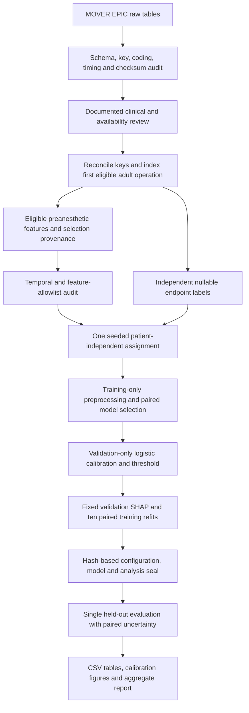

# Reproducible stage workflow

`train`, `calibrate`, `explain`, and `stability` load only their permitted saved
partitions. `evaluate` requires the seal and reads test rows only afterward.
Mutation of sealed inputs causes rejection; the test unlock is recorded once.
To amend the protocol, use a new output directory and record the rationale.

The model bundle contains fitted preprocessing, selected estimator, calibrator,
threshold and schema through the fitted column transformer. XGBoost is also
saved in native JSON. LR coefficients record their scaling/encoding conventions.
Run manifests record code/config/lock hashes, raw-input checksums, observed
software/OS/hardware and seeds. Split membership, models, predictions and
individual explanations remain private.

## Completion entries

### Generate grouped global and local explanation figures

Implemented and inspected global clinical-concept rankings, XGBoost beeswarm,
prespecified dependence plots and fixed median-risk TP/FP/TN/FN examples. Raw and
affine calibrated-logit additivity pass numerically. Missingness is reported
separately and within grouped contributions. Empty groups are explicit.

### Run ten paired training bootstrap stability refits

Both endpoint demonstrations completed ten refits for each model, using paired
patient draws, refitted preprocessing, fixed hyperparameters, a common background
and unchanged validation patients. Spearman, top-five Jaccard/inclusion, centered
attribution variability and baseline shifts are saved. These forty refits are
exploratory, not clinical-effect confidence intervals.

### Record optional VitalDB exclusion from core study

VitalDB is outside the core implementation. It can be considered only after the
main study is frozen and feature/timing/outcome harmonization is established.
No patient-wise merge or target-cohort tuning is implemented.
