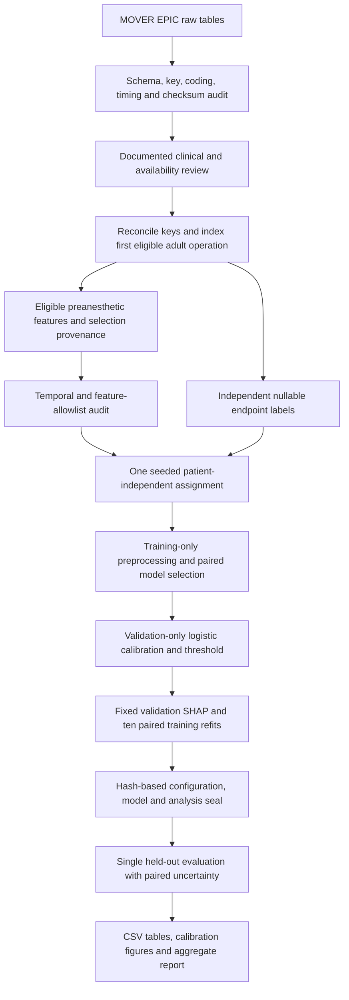

# Reproducible stage workflow

## Saved report-result artifacts

The supplied minor-project report was reviewed on 19 October 2026.
[Report result audit](report-results-audit.md) records its exact illustrative
values, eight result figures, numerical checks and differences from current
campaign artifacts. [Artifact implementation plan](report-artifacts-plan.md)
specifies a separate exact reference archive and computed campaign exports.
The implementation uses two independent command surfaces:

```powershell
uv run --locked python scripts/import_report_reference.py --source "C:\path\PreOp_XAI_Minor_Project_Report (1).docx" --output artifacts/report-reference-20261019-b20b62dc
uv run --locked preop-xai export-results --source artifacts/reliability-20261018 --output artifacts/reliability-20261018-result-exports
```

Use the supplied DOCX path from the audit, not the template above. Import requires
its exact SHA-256 and preserves the original DOCX/PNG bytes and displayed values.
Category C illustrations and category B benchmarks are reference evidence, not
measured campaign results or model targets. Historical assertions retain category A.

Both commands require a fresh destination. Campaign export writes only under ignored
`artifacts/`, outside the source tree. It checks the historical freeze's recorded
paths/hashes and completion-marker model hash before consuming saved evaluation
arrays. A historical source mismatch is a blocking integrity error, not an invitation
to reseal or rerun evaluation. Export does not fit, predict with models, deserialize
joblib, load partitions, recompute SHAP, approve review, or change source status.

The derivative contains full-precision tables, ROC/PR coordinates, five fixed and
separate ten-requested-quantile calibration bins, confusion matrices, endpoint
comparison, saved-refit stability summaries/figures and `report_artifacts.json`.
Its report reads only explicitly indexed aggregate artifacts and validates their
hashes/paths. Private/local explanations and row-level arrays remain excluded.
`build_report(output, export_manifest=path)` selects this explicit manifest mode;
ordinary campaign reporting remains available and does not discover nested campaigns.

Source evidence can be unavailable: disabled endpoints receive status entries,
unestimable calibration stays raw-only, and nonpositive-slope calibrated figures
remain invalid-fit research diagnostics. Missing legacy accuracy intervals are
not reconstructed. Historical campaign and current exporter provenance are separate.
Aggregate storage does not authorize publication. Execution receipts and the
constructed saved-array fallback fixture are documented in
[report-artifacts-execution.md](report-artifacts-execution.md).

The verified final derivative is
`artifacts/report-export-fixture-20261019-result-exports`; its 36 aggregate files
match the retained inspected `-v3` capture. Earlier invalid QA state was removed
before the canonical fresh-directory run, never overwritten. The supplied transfer DOCX changed after
archival on 19 October 2026. The isolated archive's `source/` copy retains the exact
audited fingerprint and can be used for a fresh identical import; the changed
transfer file is rejected until independently audited as a different source.



`train`, `calibrate`, `explain`, and `stability` load only their permitted saved
partitions. `evaluate` requires the seal and reads test rows only afterward.
Mutation of sealed inputs causes rejection; the test unlock is recorded once.
To amend the protocol, use a new output directory and record the rationale.

The model bundle contains fitted preprocessing, selected estimator, calibrator,
threshold and schema through the fitted column transformer. Protocol 1.1 also
writes `bundle.json` with explicit units/bounds/runtime/schema/model hash and
`calibration.json` with validation counts and fit status. `predict` loads those
artifacts without fitting; see `inference.md`. Calibration attempts can be
frozen even when invalid/unestimable so failures remain reportable; this never
approves calibrated inference. XGBoost is also
saved in native JSON. LR coefficients record their scaling/encoding conventions.
Run manifests record code/config/lock hashes, raw-input checksums, observed
software/OS/hardware and seeds. Split membership, models, predictions and
individual explanations remain private.

## Completion entries

### Generate grouped global and local explanation figures

Implemented and inspected global clinical-concept rankings, XGBoost beeswarm,
prespecified dependence plots and fixed median-risk TP/FP/TN/FN examples. Raw and
affine calibrated-logit additivity pass numerically. Missingness is reported
separately and within grouped contributions. Empty groups are explicit.

### Run ten paired training bootstrap stability refits

Both endpoint demonstrations completed ten refits for each model, using paired
patient draws, refitted preprocessing, fixed hyperparameters, a common background
and unchanged validation patients. Spearman, top-five Jaccard/inclusion, centered
attribution variability and baseline shifts are saved. These forty refits are
exploratory, not clinical-effect confidence intervals.

### Record optional VitalDB exclusion from core study

VitalDB is outside the core implementation. It can be considered only after the
main study is frozen and feature/timing/outcome harmonization is established.
No patient-wise merge or target-cohort tuning is implemented.
